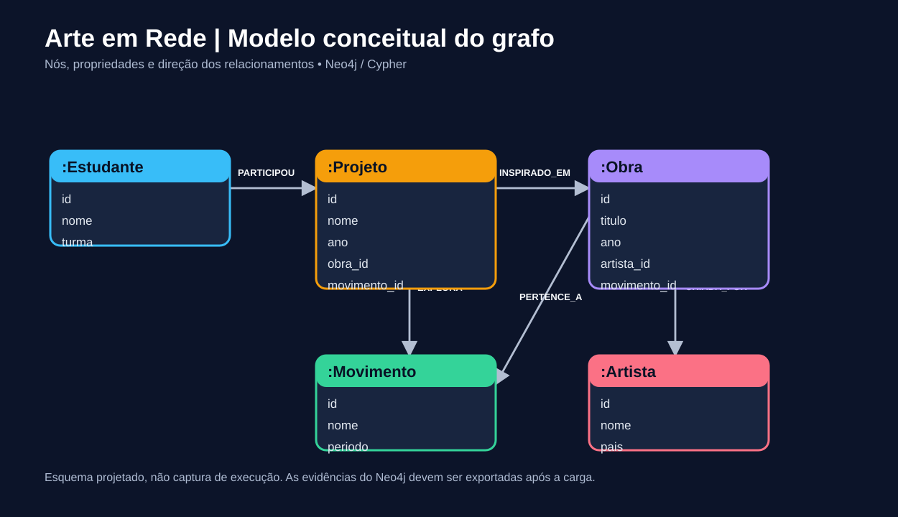

# Arte em Rede — Análise de projetos educacionais com Neo4j



**Desafio DIO | Banco de dados orientado a grafos | Neo4j + Cypher**

## 1. Contexto do problema

Como identificar a participação de estudantes em projetos de Arte, os movimentos artísticos abordados e as obras que inspiraram cada projeto? Em uma base relacional, essas perguntas exigiriam várias junções. Em um grafo, os caminhos entre estudantes, projetos, obras, artistas e movimentos são a unidade central da análise.

**Importante:** dataset didático e fictício. Os estudantes e seus vínculos são inventados. Os artistas e as obras são referências culturais; a associação didática de obras a movimentos é uma simplificação, não uma classificação historiográfica definitiva.

## 2. Objetivo e decisões de modelagem

Responder perguntas de participação, repertório artístico e recomendação de experiências. Utilizamos Neo4j porque a consulta depende principalmente de relações com vários saltos. Grafos não são necessariamente superiores para toda análise; o ganho aqui é a exploração de conexões e recomendações.

**Labels**: `Estudante`, `Projeto`, `Obra`, `Artista` e `Movimento`.

**Relações**: `(:Estudante)-[:PARTICIPOU {papel}]->(:Projeto)`, `(:Projeto)-[:INSPIRADO_EM]->(:Obra)`, `(:Projeto)-[:EXPLORA]->(:Movimento)`, `(:Obra)-[:CRIADA_POR]->(:Artista)`, `(:Obra)-[:PERTENCE_A]->(:Movimento)`.

Cada label tem um `id` único. `ano` é inteiro em `Projeto` e `Obra`. Os campos `obra_id`, `artista_id` e `movimento_id` nos nós são auxiliares de importação; as relações representam as ligações para consulta.

## 3. Estrutura

```text
neo4j-arte-educacao/
├── README.md
├── dados/
│   ├── artistas.csv
│   ├── movimentos.csv
│   ├── obras.csv
│   ├── estudantes.csv
│   ├── projetos.csv
│   └── participacoes.csv
├── scripts/
│   ├── 01_restricoes.cypher
│   ├── 02_carga_direta.cypher
│   ├── 03_carga_csv_github.cypher
│   └── 04_consultas.cypher
├── imagens/modelo-grafo.svg
└── evidencias/
    ├── grafo-completo.png
    └── LEIA-ME.md
```

## 4. Como executar (método recomendado, sem configurar URLs)

1. No Neo4j Desktop 2.2.1, abra a instância local `dnf` e selecione o banco `arteemrede` em Query. Alternativamente, crie uma instalação local própria.
2. Guarde a senha da instância em local seguro. **Não publique credenciais**.
3. Abra a ferramenta de consultas da instância (`Query`/`Neo4j Browser`).
4. Abra `scripts/01_restricoes.cypher` e execute **cada instrução separadamente**, na ordem do arquivo.
5. Abra `scripts/02_carga_direta.cypher` e execute **cada instrução separadamente**, na ordem do arquivo. Essa carga funciona sem URL pública, usando `UNWIND` e `MERGE`.
6. Abra `scripts/04_consultas.cypher` e execute as consultas Q1 a Q8 individualmente.
7. Para conferir os dados, a Q7 deve listar **6 artistas, 6 movimentos, 8 obras, 8 estudantes e 4 projetos**, totalizando **32 nós**. A Q8 deve totalizar **37 relações** (13 participações, 8 `CRIADA_POR`, 8 `PERTENCE_A`, 4 `INSPIRADO_EM` e 4 `EXPLORA`).

> A carga usa `MERGE` nos IDs e relacionamentos para permitir repetição sem duplicar os registros. Rode uma única modalidade de importação.

## 5. Como importar os CSVs diretamente do GitHub (opcional)

O método `03_carga_csv_github.cypher` demonstra `LOAD CSV WITH HEADERS` como exige o desafio.

1. Publique esta pasta num repositório GitHub **público** (ex.: `neo4j-arte-em-rede-dio`), branch padrão do repositório (por exemplo, `main` ou `principal`).
2. No arquivo `scripts/03_carga_csv_github.cypher`, substitua **todas** as ocorrências `SEU_USUARIO` pelo seu usuário real do GitHub.
3. Se o nome do repositório ou branch mudar, ajuste também essas partes das URLs.
4. Abra uma URL `https://raw.githubusercontent.com/.../dados/artistas.csv` no navegador e confirme que o CSV abre como texto antes de tentar a carga.
5. Em um banco vazio, execute o `01_restricoes.cypher` e depois as instruções do `03_carga_csv_github.cypher`, uma por vez. **Não é necessário rodar também o arquivo 02.**

> Neo4j Aura não permite `file:///` do seu computador: para o `LOAD CSV`, use arquivos remotos públicos acessíveis por HTTPS.

## 6. Perguntas de negócio e consultas

Consulte o arquivo [`scripts/04_consultas.cypher`](scripts/04_consultas.cypher) para ler as 8 consultas comentadas. Ele responde:

- Quais projetos mobilizam mais estudantes?
- Quem participa de mais de um projeto?
- Quais artistas e obras aparecem em cada projeto?
- Quais movimentos artísticos são mais explorados?
- Que projetos podem ser recomendados com base em colegas com quem o estudante já trabalhou?
- Como visualizar o subgrafo e validar contagens?

## 7. Evidências reais de execução

A imagem abaixo foi capturada na instância local `dnf`, banco `arteemrede`, e apresenta a visualização do grafo com **32 nós e 37 relacionamentos cadastrados**. A consulta de relações exibiu 31 nós conectados porque 1 movimento não possuía ligação.


As demais capturas de consultas feitas no Neo4j Desktop podem ser adicionadas à pasta `evidencias/`, com nomes `01-participacao-projetos.png`, `02-artistas-obras.png`, `03-movimentos-artisticos.png` e `04-rede-estudantes-projetos.png`. Depois de enviá-las, acrescente os links ao README.

O diagrama em `imagens/` é apenas conceitual; a captura acima é a evidência real.

## 8. Troubleshooting: problemas e diagnóstico

| Problema | Causa possível | Solução |
|---|---|---|
| `Couldn't load external resource` | URL do CSV incorreta, repositório privado ou arquivo inacessível | Confirme usuário, repositório, branch e arquivo; abra a URL raw no navegador |
| `Invalid input` ao executar script completo | Interface configurada para uma instrução por vez | Execute cada comando Cypher individualmente |
| Nenhum resultado em Q6 | Importação incompleta | Execute Q7 e Q8 para identificar labels/relações ausentes |
| Duplicações após carga | Falta de constraints ou método diferente de inserção | Execute primeiro 01; use os scripts com `MERGE` |
| Não aparece desenho após Q1 | Q1 retorna colunas escalares | Troque para Table; para imagem de grafo execute Q6 |

**Registro do projeto:** as soluções acima são orientações preventivas. Substitua por dificuldades *realmente observadas* durante sua execução, com data, erro e correção; não declare que ocorreram se não ocorreram.

## 9. Melhorias futuras

- Integrar projetos, turmas e competências curriculares com registros autorizados.
- Expandir o dataset e melhorar recomendações com similaridade e indicadores de participação.
- Anonimizar dados reais de estudantes e observar LGPD antes de publicar qualquer conteúdo.

## 10. Referências

- [Guia oficial Neo4j — Importar CSV](https://neo4j.com/docs/getting-started/data-import/csv-import/)
- [Guia oficial Neo4j — Visualização](https://neo4j.com/docs/getting-started/graph-visualization/graph-visualization/)
- [Exemplos oficiais da Neo4j](https://github.com/neo4j-graph-examples)

## Autoria e licença

Projeto educacional demonstrativo desenvolvido para desafio DIO. Dados fictícios para fins de aprendizagem. Material do repositório disponibilizado sob licença MIT (consulte `LICENSE`).
